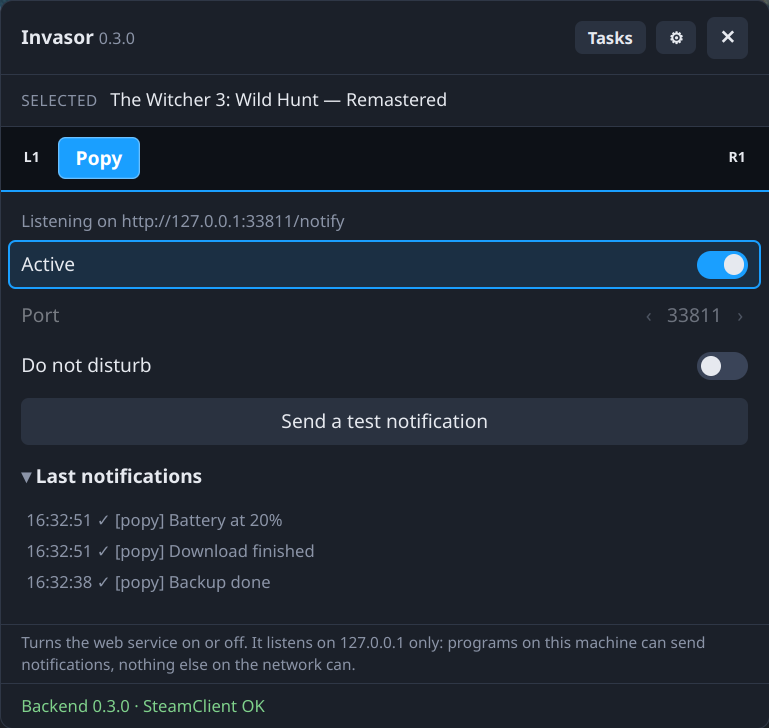

# Popy

A module for [Invasor](../invasor) that shows **your own notifications, sent over the web**, the way Steam shows an achievement. Split from Noty, together with [Cometa](https://github.com/Gamemode-Invasor/invasor-cometa).

Popy listens on **127.0.0.1** only (port 33811 by default; turn the service off in its tab to change it):

```sh
curl -X POST http://127.0.0.1:33811/notify -H 'Content-Type: application/json' \
     -d '{"title": "Backup done", "body": "42 GB copied", "icon": "/home/deck/Pictures/ok.png"}'
```

| Field | Required | |
|---|---|---|
| `title` | yes | Plain text, up to 64 characters. |
| `body` | no | Plain text, up to 256 characters. |
| `icon` | no | An `https://` image URL, `data:image/…;base64,…`, or an absolute path to a `.png`, `.jpg`, `.gif` or `.webp` file (up to 384 KB). |
| `sound` | no | `trophy`, `message`, `toast`, `chat`, `mention`, `friend`, `online`, `ingame` or `none`. Left out, Steam decides. |

Unknown fields are an error. Answers: `200 {"ok": true, "shown": true}`; `400` bad request; `413` too large; `415` not JSON; `429` more than 5 in 10 s; `503` Steam can't show it right now. With **Do not disturb** on, requests are answered `200` with `"shown": false` and nothing is shown.

## Screenshots

<p align="center">
  
</p>

<p align="center">
  
</p>

## Requirements
Invasor 0.2.0 or newer (`min_core`).

## Build, test and install
With the core checked out next to this repository (`../invasor`):

```sh
python3 ../invasor/tools/pack_module.py popy       # build, check, tests -> popy-<version>.zip
python3 ../invasor/tools/install_module.py popy    # or install that zip from ⚙ Settings › Install module
```

## Changes

### 0.1.1
- Cleaner code: what came from Noty and Popy never used is gone. Nothing changes for you.
- README: screenshots and requirements.

### 0.1.0
- First release.

## License
[GNU General Public License v3.0 or later](LICENSE) (GPL-3.0-or-later).
